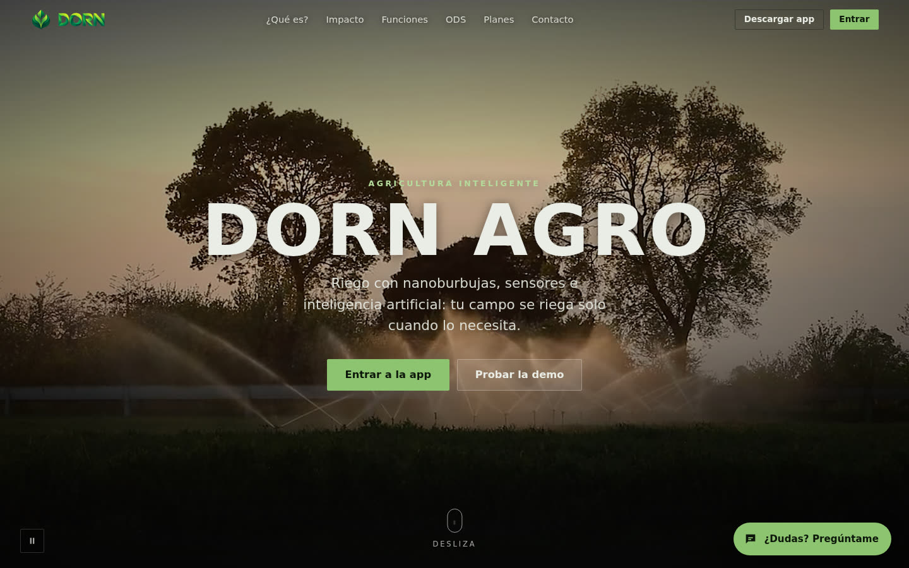
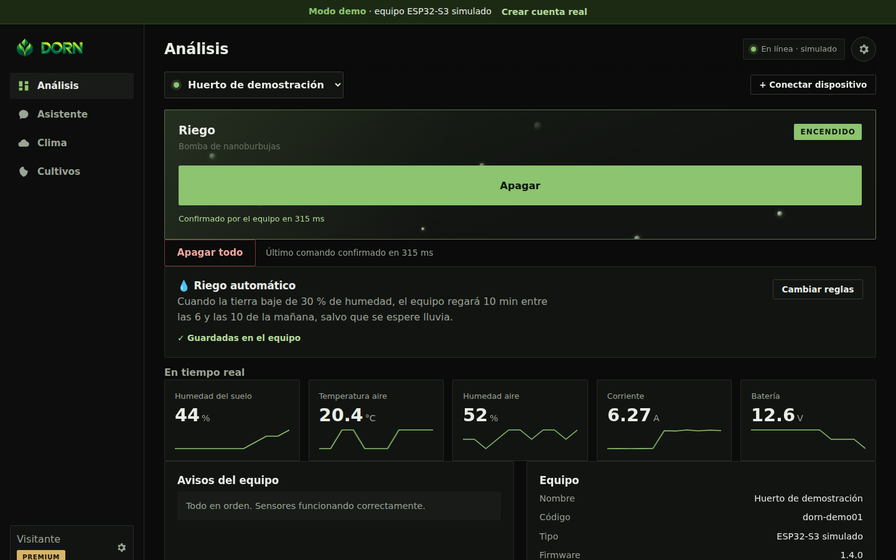
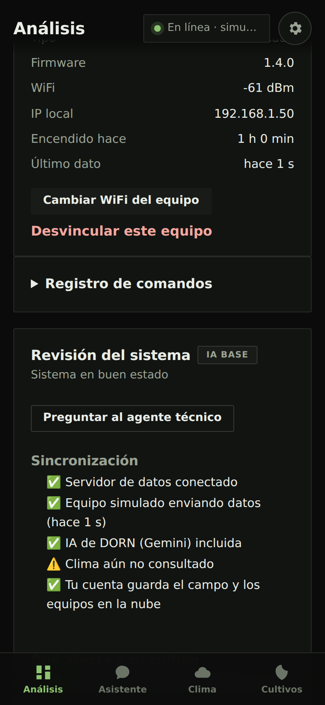
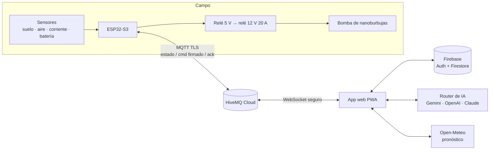

# DORN AGRO — riego inteligente con IoT e IA

Sistema de riego para pequeños agricultores: un equipo **ESP32-S3** con sensores controla una bomba de
nanoburbujas, y una **app web instalable** lo maneja en tiempo real desde el celular, con un
**asistente de IA** que lee los sensores, consulta el clima y decide cuándo regar.

**[Ver el sitio](https://joakovrd-designer.github.io/dorn-agro/)** ·
**[Probar la demo sin cuenta](https://joakovrd-designer.github.io/dorn-agro/app.html?demo)** ·
[Instalador del firmware](https://joakovrd-designer.github.io/dorn-agro/instalar.html)

## Pruébalo en 30 segundos

Abre la **[demo](https://joakovrd-designer.github.io/dorn-agro/app.html?demo)**: no pide cuenta ni hardware.
Se conecta a un ESP32-S3 **simulado** que se comporta como el real:

- Enciende la bomba y verás la confirmación del equipo (~0,3 s), la corriente subir a ~6 A y la humedad del suelo aumentar.
- Activa el **riego automático** («Cambiar reglas»): cuando el suelo baja del umbral, el equipo riega solo y corta al llegar a +15 puntos.
- Pregúntale al **Asistente** «¿cómo está el suelo?» o «enciende el riego 2 minutos»: usa herramientas para leer sensores y mover el relé.

| Panel en vivo | En el celular |
|---|---|
|  |  |

## Qué construí

| Parte | Detalle |
|---|---|
| **Firmware** (C++/Arduino) | ESP32-S3 Super Mini; un relé en GPIO 4 que activa en cascada un relé de 12 V / 20 A. Sensores de suelo, DHT22, corriente (ACS712) y batería. Protecciones por sobrecorriente, batería baja y tiempo máximo. Reglas de riego guardadas en la placa: funcionan aunque la app esté cerrada. Portal WiFi propio para configurarlo sin cables. |
| **Comunicación** | MQTT sobre TLS con **HiveMQ Cloud** (8883 en la placa, WebSocket seguro 8884 en la web). Cada comando va **firmado con HMAC-SHA256** con la clave de vinculación del equipo y un reto que cambia: tener acceso al servidor no basta para mover la bomba. |
| **App web (PWA)** | HTML + JavaScript moderno sin framework. Instalable en celular y computador, funciona sin conexión. Panel en vivo, historial de sensores, reglas de riego, clima (Open-Meteo) con pausa automática si viene lluvia y cálculo del agua por cultivo. |
| **Cuentas y datos** | Firebase Authentication (correo o Google) y Firestore con reglas que dejan a cada persona ver solo lo suyo. |
| **IA** | Router que prueba en orden Gemini (Firebase AI Logic, incluido), Gemini/OpenAI/Anthropic con la clave de la persona y, si nada responde, reglas locales. Agentes con herramientas (*function calling*) para leer sensores, accionar el relé, consultar el clima y revisar el sistema. |
| **Instalador web** | Carga el firmware en la placa desde Chrome con Web Serial (ESP Web Tools), sin instalar Arduino IDE. |
| **CI** | GitHub Actions compila el firmware con el compilador oficial y lo prueba en un ESP32-S3 simulado (Wokwi): arranca, se conecta cifrado al broker y responde comandos firmados. |

## Arquitectura

## Decisiones técnicas

- **Comandos firmados en vez de confiar en el broker.** Las credenciales MQTT viajan en la web y en el
  firmware, así que se asume que alguien puede publicar en el servidor. Por eso la placa solo obedece
  órdenes firmadas con HMAC-SHA256 con la clave de *su* equipo; el reto que cambia y un id único por orden impiden repetir una
  orden capturada.
- **Las reglas de riego viven en la placa.** Si se cae internet o se cierra la app, el campo se sigue
  regando; la app solo las edita. Las protecciones (sobrecorriente, batería, tiempo máximo) también son
  locales, porque un corte no puede depender de la red.
- **Sin framework en la web.** JavaScript moderno con módulos y sin paso de compilación para desarrollar;
  esbuild solo minifica para publicar. La app pesa poco, carga rápido en celulares de gama baja y
  funciona sin conexión gracias al *service worker*.
- **La IA nunca deja a la persona sin respuesta.** Si un proveedor falla, el router pasa al siguiente y,
  al final, a reglas locales que igual leen sensores y accionan el relé.
- **Demo con la misma interfaz que el equipo real.** El simulador implementa la misma clase que la
  conexión MQTT, así que la demo recorre el mismo código de la app y no una maqueta aparte.

## Resultados medidos

- Orden desde la web hasta el equipo y su confirmación: **0,25 s** en promedio.
- Firmware probado en un ESP32-S3 simulado: arranca y se conecta cifrado al broker en **13 s**.
- Una clave de vinculación falsa no puede manejar el equipo (probado).

## Sobre este repositorio

Aquí está la versión **compilada** que publica GitHub Pages. El código fuente, el firmware y la
documentación técnica están en un repositorio privado; puedo mostrarlos en una entrevista.

Proyecto de **[@JoakoVRD-Designer](https://github.com/JoakoVRD-Designer)**.

---

### In English

**DORN AGRO** is a smart irrigation system for small farmers. An **ESP32-S3** board reads soil, air,
current and battery sensors and drives a nano-bubble pump; an installable **web app (PWA)** controls it in
real time over **MQTT/TLS (HiveMQ Cloud)**, where every command is **HMAC-SHA256 signed** with a
per-device key and a rotating challenge. Irrigation rules and safety cut-offs run on the board, so it keeps
working offline. An **AI assistant** with function calling (Gemini via Firebase AI Logic, user-supplied
OpenAI/Anthropic keys, local rules as fallback) reads sensors, checks the weather and operates the pump.
Firmware is built and tested in CI on a simulated ESP32-S3 (Wokwi).
**[Try the live demo — no account or hardware needed](https://joakovrd-designer.github.io/dorn-agro/app.html?demo).**
